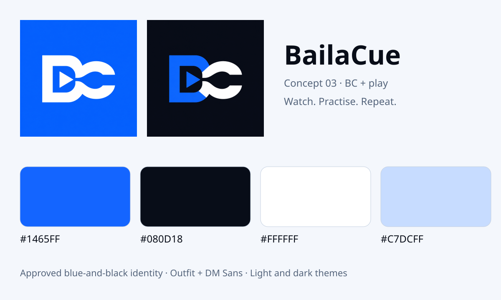

# BailaCue

**Watch. Practise. Repeat.** A private Salsa and Bachata video library for Android
and iOS, built with React Native, TypeScript and Expo SDK 58.



## Install Android

Download [BailaCue 0.2.5 for Android](https://github.com/dn-lx/BailaCue/releases/download/v0.2.5-preview.8/BailaCue-v0.2.5-build8-preview.apk)
or open [release notes](https://github.com/dn-lx/BailaCue/releases/tag/v0.2.5-preview.8).
Open it on an Android phone and allow installation from your browser/files app when
Android asks. This is an internal preview signed with a test certificate, not a
Play Store release. Version **0.2.5 (8)**; minimum Android 7/API 24.

No Metro server or Expo Go is needed for the APK. iOS needs a separate signed build
with an Apple Developer account; an Android APK cannot be installed on an iPhone.

The published APK passed ten Google ARTEMIS native checks, including actual
resize/trim-handle gestures, real import, new-file trimming, original-byte preservation,
saving to Photos and artist-label creation/reuse.
[Verification and screenshots](docs/VERIFICATION.md) record exact scope and remaining
live-provider/iOS setup. The public download exactly matches the passing native report; its signature and
version were also checked.

## What is implemented

- Original icon, adaptive icon, splash, brand badges, light/dark themes and accessible controls.
- Searchable [label dropdowns](docs/LABELS.md): choose existing video-type/artist labels or
  create new ones in imports, video details and cloud-folder defaults.
- Local import/camera recording, editable importance/status, search/source filters,
  notes/bookmarks, ordered collections, Daily Picks and practice timer/history/goals.
- Native player with draggable resize grip/presets, speed/pitch, mirror, full screen,
  seeking, timeline trim handles and named A–B loops.
- **[New trimmed MP4 files](docs/VIDEO-EDITING.md)** as separate library entries: choose phone storage or an
  exact cloud folder before saving; Save to Photos / Share / Save file for phone clips. Originals are preserved. Speed/mirror/count
  overlays are practice controls and are not baked into exported trims.
- User-selected **Drive and Dropbox accounts/folders**, defaults, folder refresh,
  stable file identities, online streaming and selective phone downloads.
- Imports/recordings offer **phone or online storage**: upload directly to a selected
  folder; retain a phone copy or remove it only after upload confirmation.
- Separate **Salsa and Bachata folder sources**, including two folders on one
  account or a mix of providers; independent defaults and Library source filters.
- Wi-Fi preference, download progress/cancel/delete, explicit online/phone choice,
  and recoverable chunked uploads with stable destinations and no original overwrite.
- Side-by-side reference/self comparison with manual offset, speed, mirror and mute;
  configurable local reminders/quiet hours and optional biometric/device lock.
- Deployed Me+ username/password gateway, BailaCue-scoped sessions, recovery/password
  change, owner-isolated manual metadata sync with revision conflicts, collection
  grants and BailaCue-only account cleanup. Enabled on mobile in build 5.

Each user connects their own video repository. OAuth still requires the app's
one-time Google/Dropbox registration: see [cloud setup](docs/CLOUD-STORAGE.md).
Google registration errors now offer a clear explanation, Files import and setup help;
**Drive sign-in still requires Google Cloud OAuth registration.** The preview contains
no invented credentials. Without provider registration, import
videos from installed cloud apps through the phone's Files picker. Local use needs
no BailaCue account. Ratings are user choices; labels start from folder defaults,
not automatic video-content analysis.

See [actual verification](docs/VERIFICATION.md) and the [full scope ledger](docs/BACKLOG.md).
Implemented source and mock tests do not imply live OAuth or physical-device validation.
New-video server push, automatic sync/merge and WebDAV/S3 adapters remain pending.

## Develop and test

Requirements: Node 24, npm; Java 21 + Android SDK/NDK for Android; macOS/Xcode for iOS.

```sh
npm ci
npm run start               # custom development build; Expo Go is insufficient
npm run android
npm run ios                 # macOS/Xcode only
npm run web
npm run typecheck
npm run lint
npm test                    # domain, mock provider/gateway, actual PostgreSQL RLS
npm run build:web -- --clear
npx playwright install --with-deps chromium
npm run test:e2e             # ffmpeg required; synthetic fixtures, no private videos
```

Browser previews support real local IndexedDB imports and compatible streaming;
mobile native export, downloads, recording and device lock require the mobile app.
Browser provider credentials are memory-only and need reconnect after reload.

## Builds and signing

```sh
export ANDROID_HOME=/path/to/android-sdk
export BAILACUE_ARCHS=arm64-v8a,x86_64
npm run build:android
```

The script generates Android from Expo config and builds a bundled release-mode APK
at `artifacts/BailaCue-v0.2.5-build8-preview.apk` with SHA-256. Native media code is
committed under `modules/baila-media`; generated root `android/` and `ios/` are ignored.
The generated internal debug certificate is used for previews; configure your own
release signing before store publication. Never commit signing keys.

EAS is supported by `eas.json`, but needs your Expo account/project and potentially
paid build capacity. iOS device distribution needs Apple signing/provisioning;
Linux cannot compile/sign it locally. No store submission is performed by CI.

## Backend and configuration

The original additive BailaCue schema is already applied to the user-approved shared
Me+ project. Existing Me+ health tables, functions and auth settings are untouched.
The owner separately approved deployment; the additional private-table migrations
and scoped Edge Function are now live. Mobile build 5 uses the scoped API. Real
registration/confirmation and two-user acceptance still need verification.

[Account API setup](docs/ACCOUNT-API.md) covers deployment, session boundaries, sync,
sharing and cleanup. [.env.example](.env.example) lists public build configuration:
`EXPO_PUBLIC_GOOGLE_WEB_CLIENT_ID`, `EXPO_PUBLIC_GOOGLE_IOS_CLIENT_ID`,
`EXPO_PUBLIC_DROPBOX_APP_KEY`, `EXPO_PUBLIC_BAILACUE_API_URL`.
Never put service/admin credentials, provider secrets or refresh tokens in public config.

## Privacy

Phone files are app-private copies; Android backup is disabled and the native iOS
module protects/excludes owned media from backups. Original provider/gallery files
are never removed by app deletion or trimming. Photos/external shares require their
own deletion. Downloads cannot be remotely revoked while offline; permission is checked
online. Disconnect/sign-out clears app copies and credentials. Keep originals in your
chosen storage. Local notification delivery depends on OS settings; no exact remote
refresh or push-delivery guarantee is made.

[Architecture](docs/ARCHITECTURE.md) · [Brand assets](docs/brand/README.md) ·
[Build brief](docs/BUILD-BRIEF.md) · [ARTEMIS testing](docs/ARTEMIS.md)
