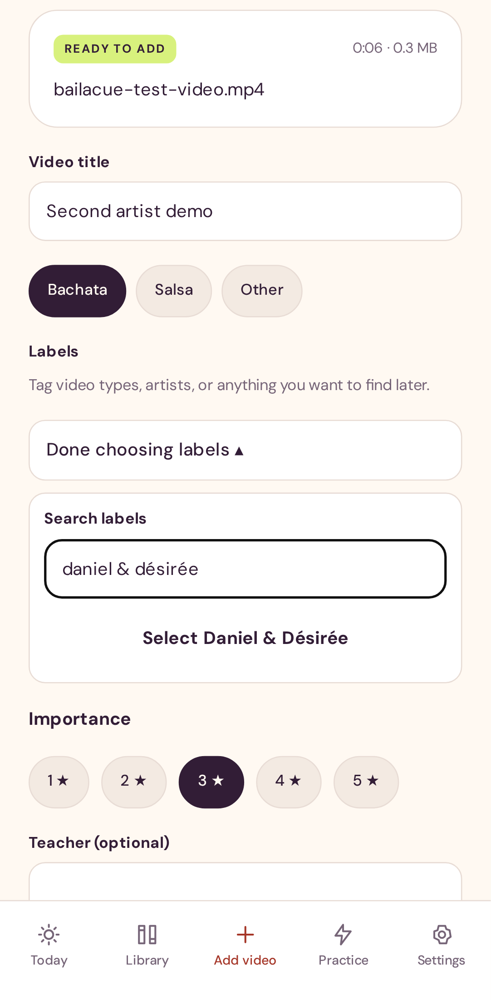

# Video and artist labels

Use the same labels for video types (such as Footwork or Partnerwork), artists in
the video, levels, events, or anything else you want to find later. A video can
have several labels.

1. When importing a video, open **Choose or create labels**. For an existing video,
   scroll to **The little details** and open the same control.
2. Browse the dropdown or type in **Search labels**. Choose **Select …** to reuse
   an existing label. If the full name is new, choose **Create “…”**.
3. Repeat for additional labels. Tap a selected label's **×** to remove it from
   this video, then close the dropdown with **Done choosing labels**.
4. Use **Add to my library** on import, or **Save details** when editing.

The dropdown suggests labels already saved on videos or cloud-folder defaults in
your current library. For folder defaults, choose labels before saving the folder;
newly discovered videos receive those defaults. Refreshing a folder preserves
labels you have edited yourself.

Search ignores capitalization; creation also ignores extra whitespace and equivalent
Unicode spellings. Existing artist accents and punctuation are preserved, so a
label such as **Daniel & Désirée** stays intact. Labels are not split at commas.
Creating a label selects it immediately; save the video or folder to retain it.
Removing a label from a video does not remove it from other videos or folders.

The Library search includes labels. Saved video labels also travel with the
existing manual metadata sync. This update uses the existing label arrays and
does not require a database migration. Labels describe what you choose to tag;
the app does not identify people from video content.

